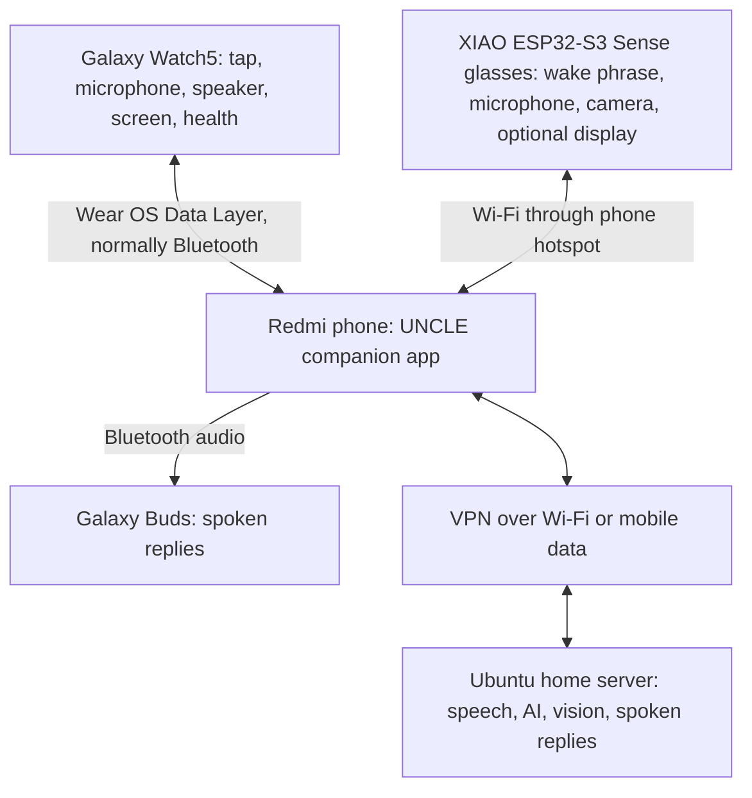

# UNCLE — Wearable AI Assistant

**User's Neural Companion for Life and Engineering**

UNCLE (also called **Θείος**, Greek for "uncle") is a personal assistant connecting a smartwatch, DIY camera glasses and optional earbuds to a home AI server. The goal is everyday use at home and outside, with the phone providing the internet connection.

> **Status: architecture and planning.** This repository currently documents the design. Apps, firmware, model integration and hardware performance have not yet been implemented or validated.

## Hardware

| Component | Role | Current status |
| --- | --- | --- |
| Redmi Note 14 Pro 4G | Companion app; gathers requests, forwards them to the server and routes responses | Existing phone |
| Samsung Galaxy Watch5 | Tap activation, microphone, spoken replies, screen, optional health data | Existing watch; UNCLE Wear OS app required |
| Seeed Studio XIAO ESP32-S3 Sense | Glasses controller, local wake phrase detection, digital microphone and camera | Planned glasses hardware |
| Galaxy Buds | Spoken replies when connected and selected for audio; optional microphone integration later | Model to be confirmed |
| Ubuntu laptop | Home server for transcription, conversation, image analysis and speech generation | Reported i5, approximately 8 GB RAM and integrated graphics; exact specifications unconfirmed |
| Optional glasses display | Short answers and status | Undecided; optical assembly and electrical interface still to be selected |

The glasses battery, enclosure, camera position, backup button and status light remain to be designed. The Sense board has no built-in speaker. Its bundled camera can vary by board revision; confirm the purchased unit.

## Hardware flowchart

The phone app terminates the local glasses connection and explicitly forwards requests to the server through the phone's VPN. We do not assume Android routes hotspot clients through its VPN. Local hotspot access and VPN routing must be tested together on the Redmi.

Buds use Bluetooth, not Wi-Fi. The watch receives audio in its UNCLE app and plays it through its speaker; it is not treated as a generic Bluetooth speaker.

## Activation and response rules

Two planned activation methods:

1. **Tap the Watch:** record through the watch microphone.
2. **Say "Hey Uncle" to the glasses:** detect the phrase locally and record through the glasses microphone.

A custom wake-phrase model requires training and outdoor testing. Continuous local detection consumes power; all-day battery life is a goal, not a verified capability. Only one microphone owns a request. A physical glasses button is a proposed backup.

| Output | Preferred route | Fallback |
| --- | --- | --- |
| Spoken answer | Buds when connected and selected | Watch speaker through the Watch app |
| Short visual answer/status | Glasses display when installed and connected | Watch screen |
| Activate, cancel, mute and connection controls | Watch | Phone app |

The phone should also offer manual text/audio access if a wearable disconnects. Automatic fallback should respect the mute setting.

## Request lifecycle

1. A wearable activates a request.
2. It captures speech; a photo is captured only when requested.
3. The phone assigns a request ID, records the input source and forwards the payload through the VPN.
4. The server transcribes speech and generates an answer, using image analysis if required.
5. The server returns answer text and spoken audio.
6. The phone routes the response to the available devices.

All devices share the same conversation through the phone/server. Persistent memory is a later feature with storage and deletion rules still to be defined.

If the server or mobile connection is unavailable, show a clear offline status. Local controls and wake detection can remain available, but server-generated answers cannot. Do not silently replay stale commands when reconnecting.

## Proposed software architecture

These are initial recommendations, not implemented or final dependency choices.

| Component | Proposed implementation | Responsibilities |
| --- | --- | --- |
| Home server | Python with FastAPI | Authenticated request API, media handling, request/session tracking, AI pipeline |
| Phone app | Native Android in Kotlin | Watch connection, glasses connection, VPN-reachable server client, response routing and connection status |
| Watch app | Wear OS in Kotlin | Tap activation, recording, text UI, playback, optional health data with permission |
| Glasses firmware | ESP32-S3 C/C++ firmware | Keyword detection, audio capture, camera capture, Wi-Fi transfer, button/LED and optional display |
| AI adapters | Server-side modules | Speech-to-text, conversation model, optional vision model and text-to-speech |

Wear OS MessageClient is suitable for small control messages; ChannelClient supports larger transfers and voice streams. Exact transport and buffering choices will be tested. The glasses need a defined protocol rather than attempting to pair them as a Bluetooth headset.

Begin with short recorded requests and ordinary HTTP uploads; introduce streaming after the complete request/reply path works. FastAPI supports file uploads and WebSockets if streaming becomes useful.

No AI model is selected yet. Benchmark the actual laptop before committing to model size, response time or simultaneous speech and vision workloads. Process one request at a time initially to limit memory use.

### Proposed project folders

- `server/`: API, session management and model adapters.
- `android/`: phone and Wear OS app modules.
- `firmware/glasses/`: XIAO firmware.
- `docs/`: hardware, protocol and setup notes.

These folders describe intended organization; application code has not been created yet.

## Development milestones

- [x] Name the project and define device roles.
- [x] Document hardware topology, activation methods and response routing.
- [ ] Confirm laptop CPU/RAM and Buds model.
- [ ] Define request/response messages and timeout/cancel behaviour.
- [ ] Prove phone-to-server connectivity over the VPN, including mobile data.
- [ ] Build phone text request/reply with a simple server response.
- [ ] Add Watch tap, audio upload and Watch playback.
- [ ] Integrate speech recognition, a small conversational model and speech generation.
- [ ] Add glasses audio and on-demand photo capture using a button first.
- [ ] Train and validate "Hey Uncle" detection.
- [ ] Test Buds/Watch audio switching, disconnects and phone background operation.
- [ ] Add health data and optional display.
- [ ] Measure battery life, outdoor microphone quality and total response latency.

The first end-to-end milestone is **tap Watch → phone → server → spoken reply on Watch**. The glasses can be added to the same protocol afterwards.

## Open decisions

- Exact laptop specifications and achievable model performance.
- English, Greek or bilingual speech support; pronunciation of the wake phrase.
- VPN implementation and simultaneous local hotspot access.
- Glasses power system, fit, microphone wind protection and thermal behaviour.
- Optional display optics, controller and connection pins.
- Which health readings are useful, how frequently to collect them and which permissions/APIs to use.
- Media retention, conversation memory and user-controlled deletion.

## Development boundaries

Use authentication in addition to the VPN; keep keys and recordings out of this public repository. Pair wearable connections deliberately and use encrypted transport where supported. Begin with explicit allowed actions rather than unrestricted model-generated shell commands. Health data is intended for personal wellness context, not diagnosis.

## Technical references

- [Seeed XIAO ESP32-S3 Sense overview](https://wiki.seeedstudio.com/xiao_esp32s3_getting_started/)
- [Seeed microphone guide](https://wiki.seeedstudio.com/xiao_esp32s3_sense_mic/)
- [Seeed keyword spotting guide](https://wiki.seeedstudio.com/xiao_esp32s3_keyword_spotting/)
- [Wear OS Data Layer clients](https://developer.android.com/training/wearables/data/client-types)
- [Wear OS voice input](https://developer.android.com/training/wearables/user-input/voice)
- [Samsung Health Sensor SDK](https://developer.samsung.com/health/sensor/overview.html)
- [Samsung Health Data SDK](https://developer.samsung.com/health/data/guide/introduction.html)
- [FastAPI file uploads](https://fastapi.tiangolo.com/tutorial/request-files/)
- [FastAPI WebSockets](https://fastapi.tiangolo.com/advanced/websockets/)

